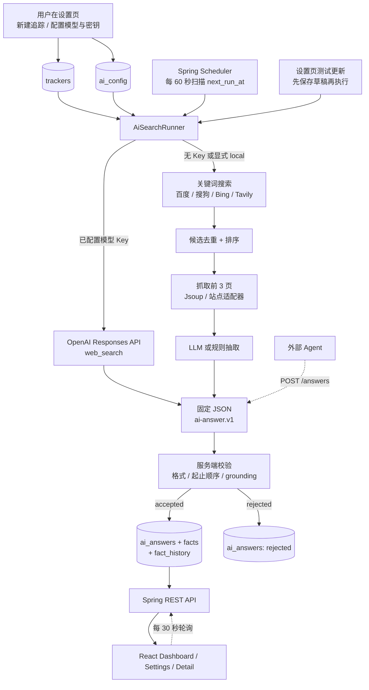
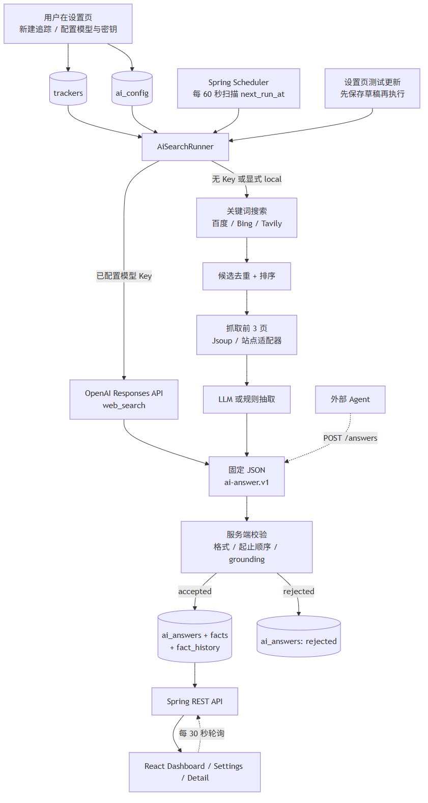

# AI 信息自动追踪 — 需求分析 v0.6（旧版）

> 2026-11 改造后，本文档描述的 AI 搜索追踪链路已被活动看板取代。当前实现见 `README.md` 与 `docs/activity-dashboard.md`。

## 0. v0.6 修订：设置中心 + 每天两次更新（2026-11-16）

用户确认后的主流程是：

1. 用户在「设置」里新建追踪，维护关键词、提示词、模型和密钥。
2. 保存关键词或提示词后，服务端自动排队执行搜索；`AiSearchRunner` 按提示词搜索全网，返回固定 `ai-answer.v1` JSON。
3. 回答先保存到 `ai_answers`，再经过 grounding / 起止顺序 / 跨度校验，写入 `facts` 和 `fact_history`。
4. React 页面只从数据库读取事实和回答记录，每 30 秒轮询，不在前端拼接或解析 AI 自然语言。

执行方式：

- **主路径 `openai-responses`**：调用 OpenAI Responses API 的联网搜索工具，模型直接给出带 URL 引用的固定 JSON。
- **自动降级**：模型端点不支持 `web_search`，或回答没有 URL 引用时，自动切换到关键词搜索 + 同一模型逐页抽取。
- **兜底 `local-search`**：没有模型 Key 时，合并百度/搜狗/Bing（配置 Tavily 时也包含）候选，抓取前 3 页并抽取；用关键词锚点校验页面是否真的在讲追踪对象。
- **外部推送（可选）**：保留 `POST /api/trackers/{id}/answers`，供其他 Agent 或脚本把回答推入库。

AI Key 可以保存在服务端设置表，也可以由环境变量提供；浏览器只看到掩码，不接触完整 Key，也不直接调用模型。

数据库核心数据：

- `trackers.prompt_text`：用户提示词。
- `trackers.auto_search`：是否允许服务端定时搜索；新建追踪默认开启。
- `ai_config`：设置页保存的模型、密钥和接口地址；启动时加载并覆盖环境变量默认值。
- `ai_answers`：AI 原始回答、模型、提示词快照、接收时间、校验状态。
- `search_runs`：每次 AI 搜索的 provider、query、来源、耗时、错误。
- `facts` / `fact_history`：当前事实与历史版本。

安全规则：无效 AI 回答标记为 `rejected` 并保留原始内容；如果已有可信结束时间，不会被无结束时间或 grounding 失败的回答覆盖。

> 状态：已实现主链路，继续补充质量与运维能力。
> v0.1 的定点 URL 与手动粘贴不再是核心入口，只作为未来可选辅助能力。
> 日期：2026-11-16

## 1. 一句话定义

用户用一句话登记要盯的信息（例：「《星海》冬日庆典什么时候结束」），系统定时让 AI 联网搜索、筛选可信来源、读取原文并抽取成固定 JSON，回传服务端校验入库，前端以卡片、倒计时和证据链呈现。

## 2. 三种来源获取方式

| 方式 | 谁来找来源 | 典型输入 | 优点 | 缺点 |
| --- | --- | --- | --- | --- |
| 定点监控 | 你 | 一个公告 URL | 稳、便宜、可复现 | 要自己找链接；发现不了新公告 |
| 手动粘贴 | 你 | 一段公告文字 | 能处理登录墙、反爬、图片 | 全手动 |
| AI 搜索 | AI | 一句话、关键词或提示词 | 自动发现、覆盖广 | 结果有噪声、成本高、必须校验 |

「定点 URL」是订阅一个已知网页；「手动粘贴」是把公告文字贴进来。这两种是早期方案里的补充手段，不是当前产品的主入口。

结论：**AI 搜索是主链路；当前 MVP 只要求关键词/提示词 + 官网域名提示，不要求用户自己找链接或粘贴正文。**

## 3. 真正要解决的问题

1. **搜索噪声**：搜出来的结果混着 SEO 垃圾、去年的旧公告、玩家转述、搬运站。要先判断「哪条是当前有效的官方信息」。
2. **来源可信**：结束时间可能分区服、分平台、写在图片里，或者官方前后改过口。
3. **抽取可信**：LLM 会把「预计」「待定」「12 月 4 日」编成一个具体时间，必须可溯源、可校验。
4. **变化可感知**：用户要的是「现在还剩多久」，不是「上周三抓过一次」。
5. **展示稳定**：固定格式的价值是前端不解析自然语言，字段缺失也有兜底，而不是让 AI 输出一段 Markdown。

## 4. 需求拆解

| 用户诉求 | 对应系统能力 | 验收方式 |
| --- | --- | --- |
| 我不想自己找链接 | AI 搜索、候选源排序、时间过滤 | 给定 20 个追踪目标，Top 3 候选中至少 1 条官方来源 |
| 我想知道活动什么时候结束 | 原文抓取、时间抽取、时区归一、状态计算 | 时间字段准确率 ≥ 95% |
| 别骗我 | 原文引用、来源标注、引用可验证、置信度 | 每条引用都能在抓取到的正文中找到 |
| 自动更新 | 定时搜索、变更检测、失败重试 | 官方延期后 2 个检查周期内更新 |
| 固定格式 | JSON Schema 契约、校验、版本号 | 前端只依赖 schema，不解析自然语言 |
| 好看且一眼看懂 | 卡片、倒计时、状态色、变更时间线 | 首屏 1.5s 内可见；剩余时间每秒更新不跳变 |

## 5. 关键场景

### US-1 一句话创建追踪
用户输入「星海冬日庆典什么时候结束」。系统生成查询、执行搜索、筛出候选源、抓取前 3 个页面、抽取事实，展示预览卡片：结束时间、来源、置信度、原文引用。用户确认后开始定时追踪。

### US-2 日常查看
打开 Dashboard，按「即将结束」排序。每张卡显示：名称、剩余时间、结束时间（本地时区）、来源、最后搜索时间、置信度。

### US-3 官方延期
官方公告把结束时间从 12-04 改为 12-11。系统检测到内容或事实变化，重新抽取，写入历史版本，卡片出现「已变更」角标，详情页展示 diff。

### US-4 搜到旧公告或假消息
搜索结果里出现去年活动、媒体转述、玩家截图。系统按发布时间、官方域名、标题匹配度过滤；多源冲突时不自动裁决，标记 `conflicts` 并降低置信度，前端提示「来源不一致」。

### US-5 来源失效
页面 404、改版或需要登录。系统不猜、不把旧值当新值，标记 `stale` / `source_dead`，前端显示「需人工确认」。用户可以调整关键词/官网域名或提示词后重新 AI 搜索；仍无结果时保持「待确认」，不伪造时间。

### US-6 回溯与追责
用户质疑「为什么显示这个时间」。详情页能展示：查询词、搜索结果、采用了哪几条来源、哪段原文、哪个模型、哪版 prompt、当时的置信度。

## 6. 数据与契约设计（核心）

### 6.1 四层数据，不要混

| 层 | 内容 | 写入方式 |
| --- | --- | --- |
| `search_runs` | 查询词、搜索 provider、候选结果、选中 URL、耗时、错误 | 每次搜索一条，只追加 |
| `snapshots` | 本地兜底抓取时的原始 HTML/文本、URL、抓取时间、内容 hash | 只追加；主链路不依赖 |
| `ai_answers` | AI 原始回答 JSON、模型、提示词快照、接收时间、校验状态、错误 | 每次调用一条，`accepted` / `rejected` 都保留 |
| `facts` / `fact_history` | 校验、合并后的当前事实与历史版本 | 覆盖当前版，同时写一条历史 |

好处：搜错、抽错可重跑；页面改版可回溯；争议时能直接指到原文和当次搜索结果。

### 6.2 两条契约，不是一条

| 契约 | 消费方 | 是否含 status | 是否含最终置信度 |
| --- | --- | --- | --- |
| `ai-extraction.v1` | 抽取服务（单页） | 否 | 否（模型自评只作输入） |
| `tracker-fact.v1` | 前端 / API | 是（服务端计算） | 是（服务端计算） |

原因：模型不该决定「活动是否结束」，也不该自评可信度当最终结论。模型只负责「把原文里的事实抽出来」。搜索结果与候选排序单独存在 `search_run`，不和事实混在一起。

文件：
- `docs/schemas/ai-extraction.v1.json`
- `docs/schemas/ai-answer.v1.json`
- `docs/schemas/tracker-fact.v1.json`
- `docs/schemas/search-run.v1.json`

### 6.3 字段设计原则

1. **时间**：一律 ISO 8601 带偏移，例如 `2026-12-04T03:59:59+08:00`；同时保留原文 `raw_text`；时区用 IANA 名（`Asia/Shanghai`）。
2. **缺失**：用 `null`，禁止猜测和占位值。`null` 在前端显示「待确认」。
3. **状态**：服务端用 `end_at` 与当前时间比较，得出 `upcoming | active | ended | unknown`。前端再根据剩余秒数决定「即将结束 / 紧急」的视觉，不重复定义业务状态。
4. **新鲜度**：单独字段 `freshness: fresh | stale | error`，不要塞进 status。
5. **来源类型**：`sources[].found_via` 当前为 `ai_answer`；未来可扩展 `search | direct_url | manual_paste`。
6. **置信度**：`overall` 由服务端根据「是否官方来源、时间校验是否通过、模型自评」计算；多源一致性与历史稳定性暂未参与。
7. **版本**：`schema_version`、`fact_version`、`prompt_version`、`model` 全部落库，任一变化可追溯。

### 6.4 防幻觉的四道闸

1. **结构校验**：服务端用 Jackson 解析固定契约，字段类型、长度和必填项由 DTO/校验逻辑卡死；`docs/schemas/*.json` 作为人工核对与后续生成类型的基准。
2. **引用核验**：本地兜底只接受实际抓取到的页面引用；模型路径目前校验 `quote` / `raw_text` 中是否有能核对 `end_at` 的日期，来源页二次抓取比对列为待补强项。
3. **Grounding 校验**：`end_at` 必须能在 `times.raw_text` 或 `sources[].quote` 中找到对应日期；MVP 以绝对日期为主，相对时间必须在原文中给出可核对依据。
4. **语义校验**：`end_at > start_at`；跨度 ≤ 2 年；时间必须能解析为带偏移的 ISO 8601。

失败处理：回答标记 `rejected` 或 `needs_review=true`；如果已有可信结束时间，不被没有结束时间或 grounding 失败的回答覆盖。前端显示「时间待确认」，**绝不展示猜测值**。

### 6.5 固定返回格式示例（`tracker-fact.v1`）

```json
{
  "schema_version": "1.0",
  "tracker_id": "trk_demo_winter_event",
  "subject": {
    "name": "《星海》冬日庆典",
    "category": "game_event",
    "region": "CN",
    "platform": "PC / iOS / Android"
  },
  "status": "active",
  "freshness": "fresh",
  "times": {
    "start_at": "2026-11-20T10:00:00+08:00",
    "end_at": "2026-12-04T03:59:59+08:00",
    "timezone": "Asia/Shanghai",
    "precision": "minute",
    "raw_text": "活动时间：2026/11/20 10:00 ~ 2026/12/04 03:59"
  },
  "key_facts": [
    { "label": "奖励", "value": "限定头像框、原石 ×420" },
    { "label": "参与条件", "value": "冒险等阶 ≥ 20" }
  ],
  "milestones": [],
  "sources": [
    {
      "url": "https://example.com/news/123",
      "title": "冬日庆典活动公告",
      "publisher": "官方",
      "is_official": true,
      "found_via": "search",
      "published_at": "2026-11-18T12:00:00+08:00",
      "fetched_at": "2026-11-16T09:00:00+08:00",
      "quote": "活动时间：2026/11/20 10:00 ~ 2026/12/04 03:59"
    }
  ],
  "confidence": {
    "overall": 0.93,
    "time": 0.98,
    "basis": ["官方来源", "原文含完整日期", "引用核验通过"]
  },
  "quality": {
    "needs_review": false,
    "review_reason": null,
    "conflicts": []
  },
  "run": {
    "last_searched_at": "2026-11-16T09:00:00+08:00",
    "last_checked_at": "2026-11-16T09:00:02+08:00",
    "last_changed_at": "2026-11-16T09:00:02+08:00",
    "next_check_at": "2026-11-16T10:00:00+08:00",
    "consecutive_failures": 0
  },
  "version": {
    "fact_version": 1,
    "model": "extract-model-v1",
    "prompt_version": "extract-v1"
  }
}
```

### 6.6 字段说明

| 字段 | 类型 | 说明 |
| --- | --- | --- |
| `status` | enum | 服务端计算：`upcoming / active / ended / unknown` |
| `freshness` | enum | `fresh / stale / error`，与状态正交 |
| `times.start_at` / `end_at` | string? | ISO 8601，未知为 `null` |
| `times.precision` | enum | `exact / minute / date / month / relative / unknown` |
| `times.raw_text` | string | 原文时间句，逐字摘录 |
| `milestones` | array | 活动内的子节点，如「兑换截止」「结算日」 |
| `sources` | array | 至少 1 条；含 URL、引用、发布时间、抓取时间、来源方式 |
| `confidence` | object | 服务端计算，附计算依据 |
| `quality.conflicts` | array | 多源冲突时保留双方，不自动裁决 |
| `run` | object | 调度与健康度信息，含上次搜索时间 |

## 7. 搜索链路设计

### 7.1 七步流水线

1. **提示词组装**：把追踪关键词、用户提示词、限定官网域名和当天日期组装成一次搜索请求。
2. **主路径搜索**：有 `AI_SEARCH_API_KEY` 时调用 OpenAI Responses API 的联网搜索工具。
3. **兜底搜索**：没有 Key 或显式配置 `local` 时，合并百度/搜狗/Bing（配置 Tavily 时也包含）候选并排序。
4. **抓取与抽取**：兜底路径抓取前 3 个候选页面，用 LLM 或规则抽取开始/结束时间。
5. **统一契约**：两条路径都产出同一个 `ai-answer.v1` JSON，附带来源 URL 和原文引用。
6. **校验入库**：时间格式、起止顺序、跨度和 grounding 通过后写 `facts`；原始回答无论通过与否都留在 `ai_answers`。
7. **页面读取**：React 每 30 秒重新请求数据库视图，不解析自然语言，也不直接消费搜索结果。

### 7.2 Query 设计

- 主路径由模型自己规划检索词，服务端只给关键词、提示词、官网域名和当天日期。
- 兜底路径由 `SearchService` 生成最多 5 条查询：原关键词、提示词摘要、`关键词 + 公告 + 年份`、`关键词 + 结束时间 + 年份`、`关键词 + site:官网域名`。
- 关键词应带主体名 + 时间意图 + 年份/版本，避免只用「活动 结束」这类泛词。
- Query 缓存暂未实现；MVP 每次重新生成。

### 7.3 候选源排序

硬过滤：
- 非法 URL 直接排除
- 百度知道、百科、问答站等低价值域名直接排除
- URL 按 canonical 去重（去掉 `utm_*`、`from`、`ref` 等追踪参数）
- 官网首页降权，避免把「官网首页」当成活动页

打分（0–1）：

| 信号 | 权重 |
| --- | --- |
| 域名在官方白名单 | +0.40 |
| 标题包含主体名/别名 | +0.20 |
| 发布时间在近 30 天内 | +0.15 |
| URL 像文章页 | +0.10 |
| 标题含公告/活动/版本/新闻等信号 | +0.08 |
| 摘要或标题含「结束 / 截止 / until / end」 | +0.10 |
| 摘要含具体日期 | +0.10 |
| 标题或摘要部分匹配关键词 | +0.10 / +0.05 |
| 是官网首页 | -0.25 |
| 发布时间超过 1 年 | -0.20 |

低于阈值的候选不抓取；全部低于阈值时，标记 `needs_review`，提示用户调整关键词、官网域名或提示词。

### 7.4 抓取与解析

- 静态页：Jsoup 抓取 HTML，提取标题、正文、发布时间和内容 hash。
- 站点适配器：已知站点（当前实现米哈游官网新闻）走专用接口，避免拿到首页或动态壳。
- 动态页、PDF、图片：MVP 不做；需要时后续再接浏览器渲染或 OCR。
- 同域限速 ≥ 5 秒/次，遵守 robots.txt，不绕过登录和验证码。

### 7.5 多源合并

当前实现保留多个来源并按官方域名优先展示，但**还没有自动冲突裁决**：`quality.conflicts` 目前为空，来源不一致时主要靠人工查看引用。后续再做多源一致性与冲突提示。

### 7.6 三种落地方式

| 方式 | 谁执行搜索 | 优点 | 缺点 | 当前定位 |
| --- | --- | --- | --- | --- |
| A. 模型原生搜索 | 模型（Responses `web_search`） | 接入快、覆盖广、能直接给 URL 引用 | 引用仍需服务端再校验 | **主路径** |
| B. 服务端编排 | 服务端调关键词搜索 + 抓取 + 抽取 | 可控、可缓存、可核验、可换 provider | 代码量更大，受页面反爬影响 | **无 Key 兜底** |
| C. 外部 Agent 推送 | 外部定时 Agent | 灵活，能跑复杂浏览器操作 | 依赖外部调度，稳定性难保证 | 可选补充 |

当前主路径是 A：服务端把用户提示词交给模型，模型调用联网搜索并返回固定 JSON；服务端只负责校验和入库。B 用于没有模型 Key 的环境，保证链路仍能跑通。C 通过 `POST /api/trackers/{id}/answers` 接入，不是必需。

### 7.7 「全网」的边界

- 只搜公开可访问页面，不碰登录墙和付费内容
- 限定语言、地区、时间窗，避免旧公告污染
- 官方域名白名单优先，但不排斥媒体交叉验证
- 搜索 provider 有配额限制，需要缓存与降频；MVP 先不设成本目标

## 8. 调度与成本

### 8.1 自适应频率

- 默认每天更新 2 次，即每 12 小时一次（`default-interval-minutes=720`）
- 临近结束也保持每天 2 次，不再单独加速
- 每条追踪在设置页提供「测试更新」按钮，可立即按当前提示词执行一次，不改变定时计划
- 失败后按 `5 × 连续失败次数` 分钟退避，最长 60 分钟
- 调度器每 60 秒扫描一次 `next_run_at`，单条失败不影响其他追踪

### 8.2 成本控制（MVP 延后）

当前阶段优先保证「能搜到、能校验、能展示」，暂不设硬性成本上限。正式长期运行前再补：

- 搜索 query 和结果按 TTL 缓存（普通期 6 小时，临近结束 30 分钟）
- 多 tracker 共享同域抓取结果
- 正文裁剪后再送模型，只保留标题、时间附近段落和公告正文
- hash 未变不重复抽取
- 每个 tracker 设日预算，超限降频并告警

## 9. 系统架构





### 模块职责

| 模块 | 职责 | 不做什么 |
| --- | --- | --- |
| 设置页 / REST API | 新建追踪，保存关键词、提示词、模型、密钥和自动搜索开关 | 不解析 AI 回答 |
| 调度器 | 按 `next_run_at` 扫描到期追踪，触发搜索 | 不抓取、不抽取 |
| `AiSearchRunner` | 组装提示词，选择模型联网搜索或本地兜底 | 不直接把结果写成事实 |
| `SearchService` / providers | 返回候选结果，去重后排序 | 不判断真假 |
| `PageFetcher` / 站点适配器 | 抓 HTML/文本、跟随重定向、限速 | 不调 LLM |
| 抽取器 | 调用模型或规则，产出时间与原文引用 | 不判断活动状态、不写库 |
| `AiAnswerService` | 校验回答，写 `ai_answers`、`facts`、`fact_history` | 不修改模型原始回答 |
| `FactValidator` | 时间格式、起止顺序、跨度、grounding | 不修补猜测值 |
| React 页面 | 卡片、倒计时、来源引用、AI 回答记录 | 不解析自然语言 |

### 技术选型（已确定）

- 后端：Java 17 + Spring Boot 3.3 + Spring Web + Spring Data JPA + H2（PostgreSQL 兼容模式）
- 前端：React 18 + TypeScript + Vite
- 主搜索：OpenAI Responses API + `web_search_preview` / `web_search`
- 兜底搜索：百度 / 搜狗 / Bing，可选 Tavily；Jsoup 抓取；LLM 或规则抽取
- 调度：Spring `@Scheduled`，默认每 60 秒扫描一次到期任务
- 契约：`docs/schemas/*.json`；前端类型在 `frontend/src/types.ts`

## 10. API（当前实现）

| 方法 | 路径 | 作用 |
| --- | --- | --- |
| `GET` | `/api/trackers` | 追踪列表，按结束时间排序 |
| `POST` | `/api/trackers` | 创建追踪，可传关键词、提示词、官网域名、`auto_search`、`run_now`；`run_now=false` 时首轮排到 12 小时后 |
| `GET` | `/api/trackers/{id}` | 当前事实、搜索记录、变更历史、AI 回答记录 |
| `PATCH` | `/api/trackers/{id}` | 修改关键词、提示词、官网域名、自动搜索开关 |
| `DELETE` | `/api/trackers/{id}` | 删除追踪及其回答、历史、搜索记录 |
| `POST` | `/api/trackers/{id}/refresh` | 按已保存配置立即执行一次测试更新，不改变定时计划 |
| `POST` | `/api/trackers/{id}/test` | 保存当前草稿并立即测试，不排队、不改变定时计划 |
| `GET` | `/api/trackers/{id}/answers` | 查看最近的 AI 回答（含 rejected） |
| `POST` | `/api/trackers/{id}/answers` | 外部 Agent 推送固定 JSON 回答 |
| `GET` | `/api/settings/trackers` | 设置页列表 |
| `GET` | `/api/settings/trackers/{id}` | 单条追踪设置 |
| `GET` | `/api/settings/ai` | 当前模型、接口地址、密钥掩码和来源 |
| `PUT` | `/api/settings/ai` | 保存模型、密钥、接口地址，立即生效 |
| `GET` | `/api/config` | 当前 AI 搜索引擎、模型、是否配置 Key |
| `GET` | `/api/health` | 健康检查 |

响应直接返回 DTO 对象或数组，不再额外包一层 `data/error`。错误由 `ApiExceptionHandler` 统一转成 `{ "message": "..." }`。

## 11. 前端设计

### 页面

1. **Dashboard**：只负责展示和筛选；卡片列表默认按剩余时间排序，可筛选 `全部 / 进行中 / 48h 内结束 / 已结束 / 待复核`；每 30 秒从数据库拉取一次。
2. **Settings**：新建追踪；配置模型、密钥和接口地址；每条追踪维护关键词、官网域名、提示词和自动搜索开关；保存后若关键词/提示词有变化且自动搜索开启，服务端排队执行一次搜索；每条追踪有「测试更新」按钮，测试前会保存当前草稿。
3. **Detail**：大倒计时、起止时间、关键信息、来源与原文引用、AI 回答记录、搜索记录、变更历史；每 30 秒重新读取数据库。

### 组件

| 组件 | 内容 |
| --- | --- |
| `TrackerCard` | 名称、状态徽标、剩余时间、结束时间、来源图标、置信度提示 |
| `Countdown` | 客户端每秒计算，`days/hours/minutes/seconds`；标签页隐藏时暂停 |
| `StatusBadge` | upcoming 蓝、active 绿、ended 灰、unknown 黄；`ending_soon` 由前端按剩余时间派生为橙色 |
| `SourceList` | 来源、是否官方、来源方式、发布时间、原文引用（可展开） |
| `SearchTrace` | 本次查询词、候选数量、采用了哪几条、为什么选它 |
| `ChangeTimeline` | 每次字段变更的时间、旧值 → 新值、触发来源 |
| `StaleBanner` | 「数据可能过期，最后成功检查于 …」+ 手动刷新 |
| `ConfidenceHint` | 低置信度时显示「时间待确认」，不显示具体倒计时 |

### 展示规则

- 剩余时间由 `end_at - now` 计算，服务端只给时间戳，避免时区错乱。
- 详情页显示 `times.timezone` 和精度；倒计时按浏览器本地时间渲染。
- `end_at = null` 或 `needs_review = true`：不显示倒计时，显示「结束时间待确认」。
- 剩余 < 48h：橙色；< 3h：红色脉冲（尊重 `prefers-reduced-motion`）。
- 已结束：灰色 +「已于 X 结束」，不再显示负数倒计时。
- 搜索中：卡片显示「正在搜索…」，不阻塞其他卡片。
- 没搜到可信来源：保持「待确认」，提示调整关键词、官网域名或提示词；不伪造时间。

## 12. 非功能需求

| 维度 | 要求 |
| --- | --- |
| 正确性 | 时间字段准确率 ≥ 95%（20 条 gold set）；不得出现无来源的具体时间 |
| 搜索质量 | 20 个目标中，Top 3 候选中至少 1 条官方来源的比例 ≥ 80% |
| 时效性 | 自动更新每天 2 次，检测延迟 ≤ 12 小时；需要即时结果时使用测试更新 |
| 成本 | MVP 暂不设硬性上限；正式运行前再压测单次成本并加预算与降频 |
| 可观测 | 每次 run 记录 query、provider、候选数、耗时、错误；AI 回答保留原始 JSON、模型和提示词快照 |
| 合规 | 遵守 robots.txt；同域限速 ≥ 5s/次；不绕过登录与验证码；展示来源 |
| 可用性 | API p95 < 300ms；首屏 < 1.5s；单 tracker 失败不影响其他 tracker |
| 可维护 | prompt 与 schema 可通过 `ai_answers` 快照追溯；search provider 可替换 |
| 可替换 | 搜索 provider 与模型解耦，至少支持两家可切换 |

## 13. MVP 范围

### 做

- 设置页新建追踪（关键词 + 可选官网域名 + 可选提示词）
- 设置页维护提示词，保存后服务端自动执行
- 设置页保存模型、密钥和接口地址，重启后仍然生效
- 主路径：OpenAI Responses 联网搜索 → `ai-answer.v1` → 校验入库
- 兜底：百度/搜狗/Bing/Tavily 候选合并 → 抓取前 3 页 → 抽取 → 关键词锚点校验
- H2 存储 `search_runs`、快照、`ai_answers`、当前事实、变更历史
- 每天 2 次自动更新 + 每条追踪的「测试更新」
- Dashboard 卡片 + 倒计时 + 详情 + 搜索记录 + 变更时间线
- 外部 AI 回答入库接口
- （后续）gold set 回归脚本

### 不做（MVP 之后）

- 多用户、登录、权限
- 图片 OCR、视频字幕、PDF 解析
- 微信/邮件/推送通知
- 复杂浏览器 Agent（自动点页面、填表单）
- 移动端 App
- 复杂图表与运营后台

### 里程碑

| 阶段 | 内容 | 预估 |
| --- | --- | --- |
| M0 | 契约冻结 + 假数据前端（卡片/倒计时/详情） | 1–2 天 |
| M1 | 搜索 + 抓取 + 抽取 + 校验 + H2，单目标跑通 | 3–4 天 |
| M2 | 调度 + 变更历史 + stale/失败处理 | 2 天 |
| M3 | 提示词设置 + 服务端 AI 搜索执行器 + 回答审计 | 2–3 天 |
| M4 | 多 provider、OCR、通知、外部 Agent ingest | 3–5 天 |

## 14. 风险清单

| 风险 | 影响 | 对策 |
| --- | --- | --- |
| 搜索结果投毒 / SEO 垃圾 | 抽到错误或过期信息 | 官方白名单、时间过滤、多源交叉、低分不抓 |
| 搜到旧版本公告 | 显示去年活动时间 | 发布时间过滤 + 标题版本匹配 + 历史对比 |
| 模型编造 URL 或引用 | 证据链失效 | 当前校验 quote/raw_text 中的日期；来源页二次抓取比对列为待补强项 |
| LLM 幻觉日期 | 展示错误结束时间 | grounding + 原文引用 + 低置信度不显示倒计时 |
| 时区 / 跨年 / 相对时间 | 差 8 小时或差一年 | 存原始文本 + IANA 时区 + 回归用例；相对时间要求原文有可核对依据 |
| 同一活动分区服不同时间 | 只显示一个错误时间 | `region` 字段 + 多源冲突保留 |
| 活动延期 / 提前结束 | 信息过期 | 定时复查 + 结束后 24h 再确认 + 页面 30 秒轮询 |
| 搜索 API 限流 / 涨价 | 任务失败或成本上升 | provider 抽象 + 缓存 + 预算 + 降频 |
| 反爬与频率限制 | 抓取失败 | 限速、退避、遵守 robots、优先 RSS/官方 API |
| 法律与 ToS | 下架风险 | 只抓公开页面、注明来源、不存储用户隐私、不绕过访问控制 |

## 15. 待确认决策

1. **部署形态**：本机常驻，还是一台小 VPS？定时任务需要常驻进程，不建议 Serverless。
2. **来源页二次校验**：是否对所有模型返回的 `sources[].url` 都重新抓取并比对 `quote`？更可信，但会受反爬和动态页影响。
3. **通知渠道**（可选）：邮件 / 微信 / Telegram。MVP 不做。
4. **本地兜底是否长期保留**：它可以保证无 Key 时链路可用，但搜索结果波动较大。

## 16. 验收标准（MVP）

- [x] 设置页可以保存提示词，页面重新读取后仍然存在
- [x] 设置页可以新建追踪，Dashboard 不再承担创建入口
- [x] 设置页可以保存模型、密钥和接口地址，密钥只返回掩码，重启后仍生效
- [x] 服务端默认每 12 小时更新一次，即每天 2 次
- [x] 每条追踪保留「测试更新」按钮，可立即执行一次且不改变定时计划
- [x] 修改关键词/提示词并保存后，自动搜索开启时会把 `next_run_at` 置为当前时间，下一轮调度自动执行
- [x] 新建追踪默认开启定时 AI 搜索，也可手动「测试更新」
- [x] AI 回答按 `ai-answer.v1` 入库，原始 JSON、模型、提示词快照留档
- [x] `end_at` 无法在 `times.raw_text` / `sources[].quote` 中核对时拒绝入库
- [x] 已有可信结束时间时，无效回答不会覆盖上次结果
- [x] 无结束时间时页面显示「待确认」，不显示倒计时
- [x] 详情页能查看来源 URL、原文引用、AI 回答记录、搜索记录和变更历史
- [x] 页面每 30 秒从数据库重新读取，不解析 AI 自然语言
- [x] 后端 `mvn test`、前端 `npm run build` 通过
- [ ] 20 个目标中，Top 3 候选源包含官方来源的比例 ≥ 80%
- [ ] 20 条 gold set 中，`start_at` / `end_at` 字段准确率 ≥ 95%
- [ ] 官方修改结束时间后，2 个检查周期内更新并产生历史记录
- [ ] （MVP 外）再评估单次全链路成本与缓存策略
